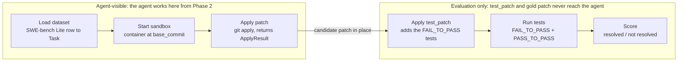

# Phase 1: Sandbox + Test Runner (Details)

As of 2026-10-06. Expands Phase 1 of [PLAN.md](PLAN.md).

## Overview

Phase 1 builds the evaluation harness: one command runs a SWE-bench Lite task plus a patch in a Docker sandbox and prints resolved or not resolved. There is no LLM in this phase. Budget is 3-5 days.

Everything later depends on it. The agent loop (Phase 2), the context strategies (Phases 3-4) and the benchmark (Phase 5) all score through this harness, so a wrong pass/fail here corrupts every result after it.

**Goals**

- Load SWE-bench Lite tasks into a typed `Task` object.
- Run each attempt in a fresh, isolated container checked out at the task's `base_commit`.
- Apply a patch, run the hidden tests, and score the attempt the same way official SWE-bench does.
- Prove the harness is correct with gold, empty and broken patches before any agent touches it.

## Scope

Phase 1 covers the harness only; anything that generates a patch belongs to Phase 2 or later.

| In scope | Out of scope |
| --- | --- |
| Loading SWE-bench Lite from Hugging Face | Any LLM call or agent loop |
| A Docker sandbox per attempt | The `read` / `write` / `edit` / `bash` agent tools |
| Applying a unified diff with `git apply` | Context strategies and the code graph |
| Running FAIL_TO_PASS and PASS_TO_PASS tests | Running more than 3-5 dev tasks |
| Scoring resolved / not resolved | Cost, token and latency tracking (only wall-clock runtime is recorded) |
| Gold, empty and broken patch validation | Non-Python repos, feature tasks, chat mode |

Phase 0 reading of the SWE-agent eval harness runs alongside this phase and should land first, since it shapes the sandbox decision.

## Architecture

The harness is a straight pipeline with one hard boundary: hidden tests are added only after the candidate patch is in place.



In Phase 1 the candidate patch is the gold, empty or broken patch; from Phase 2 the agent produces it. A patch that fails `git apply` stops the run and scores not resolved.

**Proposed module layout** (under `src/agent/harness/`)

| Module | Responsibility |
| --- | --- |
| `dataset.py` | Load SWE-bench Lite, build `Task` objects, select dev tasks |
| `sandbox.py` | Start, exec in, and tear down a container per attempt, with timeout and limits |
| `patch.py` | `apply_patch` and `ApplyResult` |
| `runner.py` | Apply `test_patch`, run tests, parse into `TestResult` |
| `scoring.py` | `is_resolved`, reusing SWE-bench grading |
| `cli.py` | The one command: task id + patch file in, verdict and runtime out |

## Implementation tasks

Seven tasks, in build order. Each one ends with something you can run.

1. **Load the dataset**
    - Pull `princeton-nlp/SWE-bench_Lite` with Hugging Face `datasets`.
    - Map each row to a `Task` dataclass: `instance_id`, `repo`, `base_commit`, `problem_statement`, `FAIL_TO_PASS`, `PASS_TO_PASS`, `gold_patch`, `test_patch`.
    - The dataset stores the gold patch as `patch` and the two test lists as JSON strings; parse them into `list[str]` at load time.
    - Pick 3-5 dev tasks from repos that install quickly.
2. **Build the sandbox**
    - One Docker container per attempt, with a fresh working copy at `base_commit` and the repo's dependencies installed.
    - The agent's filesystem is the container only; nothing on the host is mounted.
    - Use SWE-bench's published per-instance images (faster start, comparable numbers). Time one gold-patch run per dev task; build images locally only if emulated runtime is too high.
3. **Apply patches**
    - `apply_patch(sandbox, diff)` runs `git apply` inside the container.
    - Returns a structured result: applied or not, plus the error text.
4. **Run tests**
    - Apply `test_patch` only at evaluation time, never before the agent runs.
    - Run FAIL_TO_PASS and PASS_TO_PASS, then parse a status per test.
    - Return `TestResult`: per-test status, truncated raw output, runtime.
5. **Score**
    - Resolved = every FAIL_TO_PASS test passes and every PASS_TO_PASS test still passes.
    - Reuse the official SWE-bench log parsers and grading where possible.
6. **Validate the harness**
    - Gold patch: must score resolved. Empty patch: must not. Broken patch: must not, with a readable error.
    - If the gold patch ever fails, fix the harness before moving on.
7. **Check isolation and limits**
    - Confirm hidden tests and the gold patch are unreadable from anything the agent will later see.
    - Put a timeout and CPU/memory limits on every container run.

**Core types (proposed)**

```python
@dataclass(frozen=True)
class Task:
    instance_id: str
    repo: str
    base_commit: str
    problem_statement: str
    FAIL_TO_PASS: list[str]
    PASS_TO_PASS: list[str]
    gold_patch: str
    test_patch: str

@dataclass
class ApplyResult:
    applied: bool
    error: str | None

@dataclass
class TestResult:
    statuses: dict[str, Literal["passed", "failed", "error", "skipped"]]
    raw_output: str  # truncated
    runtime_s: float

def apply_patch(sandbox: Sandbox, diff: str) -> ApplyResult: ...
def run_tests(sandbox: Sandbox, task: Task) -> TestResult: ...
def is_resolved(task: Task, result: TestResult) -> bool: ...
```

## Definition of done

Phase 1 is done when every box below is ticked.

- [ ] One command runs a task plus a patch through the sandbox and prints resolved / not resolved.
- [ ] The gold patch resolves all 3-5 dev tasks, on repeated runs.
- [ ] The empty patch scores not resolved on every dev task.
- [ ] A broken patch scores not resolved and surfaces the `git apply` error.
- [ ] Hidden tests and the gold patch are not readable from inside the agent's sandbox before evaluation.
- [ ] Every container run has a timeout and resource limits.
- [ ] Runtime per task is measured and written down; it feeds the Phase 5 cost estimates.

## Risks and open questions

The biggest risk is environment setup, not code.

| Risk | Mitigation |
| --- | --- |
| Dependency installs for old repo versions fail or take hours | Start with the easiest repos; drop any task that fights you |
| Docker images and disk usage grow fast | Prune containers and dangling images between runs |
| Published SWE-bench images are x86_64; this machine runs macOS, likely on Apple Silicon | Expect slow emulation, or build arm64 images locally if runtime is too high |
| Harness quietly disagrees with official scoring | Reuse SWE-bench's own grading and check gold-patch results against it |
| Hidden tests leak into what the agent sees | Apply `test_patch` only after the agent finishes, in the evaluation step |

**Open questions**

- Published images or self-built images? Decided: start with published images; build locally only if emulated runtime is too high.
- Call the `swebench` package directly, or wrap only its log parsers and grading?
- Which 3-5 dev tasks? Record the picks and why in the repo.

**Next:** Phase 2 plugs a bare agent loop (four tools, about 5 iterations) into this harness.
