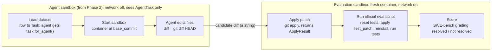

# Phase 1: Sandbox + Test Runner (Details)

As of 2026-10-10. Expands Phase 1 of [PLAN.md](PLAN.md). **Status: done.** Dev tasks, measured runtimes and findings are in [DEV_TASKS.md](DEV_TASKS.md).

## Overview

Phase 1 builds the evaluation harness: one command runs a SWE-bench Lite task plus a patch in a Docker sandbox and prints resolved or not resolved. There is no LLM in this phase. Budget is 3-5 days.

Everything later depends on it. The agent loop (Phase 2), the context strategies (Phases 3-4) and the benchmark (Phase 5) all score through this harness, so a wrong pass/fail here corrupts every result after it.

**Goals**

- Load SWE-bench Lite tasks into a typed `Task` object.
- Run each attempt in a fresh, isolated container checked out at the task's `base_commit`.
- Apply a patch, run the hidden tests, and score the attempt the same way official SWE-bench does.
- Prove the harness is correct with gold, empty and broken patches before any agent touches it.

## Scope

Phase 1 covers the harness only; anything that generates a patch belongs to Phase 2 or later.

| In scope | Out of scope |
| --- | --- |
| Loading SWE-bench Lite from Hugging Face | Any LLM call or agent loop |
| A Docker sandbox per attempt | The `read` / `write` / `edit` / `bash` agent tools |
| Applying a unified diff with `git apply` | Context strategies and the code graph |
| Running FAIL_TO_PASS and PASS_TO_PASS tests | Running more than 3-5 dev tasks |
| Scoring resolved / not resolved | Cost, token and latency tracking (only wall-clock runtime is recorded) |
| Gold, empty and broken patch validation | Non-Python repos, feature tasks, chat mode |

## Architecture

The harness is a straight pipeline with one hard boundary: hidden tests appear only after the candidate patch is final, in a separate container from the one the agent works in.



In Phase 1 the candidate diff is the gold, empty or broken patch; from Phase 2 the agent produces it. A patch that fails `git apply` stops the run and scores not resolved. Only the diff crosses from the agent's container to the evaluation container, so nothing else the agent did (installed packages, stray files) affects the score, as in official SWE-bench.

**Module layout** (under `src/agent/harness/`)

| Module | Responsibility |
| --- | --- |
| `dataset.py` | Load SWE-bench Lite into `Task` models, the agent-safe `AgentTask` view, the dev task list |
| `sandbox.py` | Start, exec in, and tear down a container per attempt, with timeouts, limits and network control |
| `patch.py` | `apply_patch` and `ApplyResult` |
| `runner.py` | Run the task's official eval script, parse the log into `TestResult` |
| `scoring.py` | `score` / `is_resolved`, using SWE-bench's grading |
| `evaluate.py` | `evaluate(task, diff)`: the whole pipeline in a fresh container; Phase 2 calls this |
| `cli.py` | The `harness` command: `run` (task id + patch in, verdict and runtime out) and `validate` |

## Implementation tasks

Seven tasks, in build order. Each one ends with something you can run. All seven are done.

1. **Load the dataset**
    - Load `SWE-bench/SWE-bench_Lite` with Hugging Face `datasets`. It is the SWE-bench team's copy of `princeton-nlp/SWE-bench_Lite`: the same 300 tasks (corrected test lists for `sympy__sympy-13177`), plus each task's published image, official eval script and log parser.
    - Map each row to a frozen pydantic `Task`. The dataset calls the gold patch `patch`, and older copies store the two test lists as JSON strings; both are handled at load time.
    - Dev tasks: five from requests, flask, pytest and seaborn, listed with the reasons in [DEV_TASKS.md](DEV_TASKS.md).
2. **Build the sandbox**
    - One Docker container per attempt from SWE-bench's published per-instance image, which has the repo at `/testbed` and its dependencies installed in a conda env. The sandbox checks the repo is at `base_commit` (the images add one mode-only `SWE-bench` commit on top).
    - The images are x86_64 only; on Apple Silicon they run emulated, at about 4-6 s per evaluation, so no local builds are needed.
    - Nothing on the host is mounted; the container's filesystem is all the agent sees.
3. **Apply patches**
    - `apply_patch(sandbox, diff)` writes the diff to a file outside `/testbed` and runs `git apply` on it, all or nothing.
    - Returns an `ApplyResult`: applied or not, plus git's error text. An empty diff counts as applied and changes nothing.
4. **Run tests**
    - `run_tests(sandbox, task)` runs the task's official eval script, which resets the test files to `base_commit`, applies `test_patch`, reinstalls the package where the repo needs it, and runs the repo's own test command (Django uses `./tests/runtests.py`, not pytest).
    - The log is parsed with SWE-bench's `get_logs_eval`: the repo's log parser plus upstream's validity checks (markers present, test exit code consistent with the log).
    - Returns a `TestResult`: per-test status, whether the log is valid, the end of the raw output, runtime, timed out.
5. **Score**
    - Resolved = every FAIL_TO_PASS test passes and every PASS_TO_PASS test still passes, computed with SWE-bench's `get_eval_tests_report` and `get_resolution_status`.
    - An invalid run resolves nothing, and a listed test missing from the log counts as a failure.
6. **Validate the harness**
    - `uv run harness validate` runs the gold patch twice, the empty patch and a broken patch on every dev task. All 20 runs score as expected; the broken patch reports git's error.
7. **Check isolation and limits**
    - The agent's sandbox has no network, no remotes or future commits in git, and no copy of the fixed files or hidden tests, except for newer `requests` releases bundled in the images (6 Lite tasks; see [DEV_TASKS.md](DEV_TASKS.md)).
    - Every container has memory, CPU, process and lifetime limits, and every command a timeout. `tests/integration_tests/test_isolation.py` repeats the checks.

**Core types**

```python
class Task(BaseModel):  # frozen
    instance_id: str
    repo: str
    base_commit: str
    problem_statement: str
    FAIL_TO_PASS: tuple[str, ...]
    PASS_TO_PASS: tuple[str, ...]
    gold_patch: str      # evaluation only
    test_patch: str      # evaluation only
    version: str
    image: str
    eval_type: str
    log_parser: str
    eval_script: str     # evaluation only; embeds test_patch

    def for_agent(self) -> AgentTask: ...  # instance_id, repo, base_commit, problem_statement

class ApplyResult(BaseModel):
    applied: bool
    error: str | None

class TestResult(BaseModel):
    statuses: dict[str, Literal["PASSED", "FAILED", "SKIPPED", "ERROR", "XFAIL"]]
    valid: bool
    raw_output: str  # end of the log
    runtime_s: float
    timed_out: bool

class Score(BaseModel):
    resolved: bool
    status: Literal["RESOLVED_FULL", "RESOLVED_PARTIAL", "RESOLVED_NO"]
    fail_to_pass: TestOutcomes  # success / failure lists
    pass_to_pass: TestOutcomes

def apply_patch(sandbox: Sandbox, diff: str) -> ApplyResult: ...
def run_tests(sandbox: Sandbox, task: Task) -> TestResult: ...
def score(task: Task, result: TestResult) -> Score: ...
def is_resolved(task: Task, result: TestResult) -> bool: ...
def evaluate(task: Task, diff: str) -> Evaluation: ...
```

Status names follow SWE-bench's, so `TestResult.statuses` goes straight into its grading.

## Definition of done

Phase 1 is done when every box below is ticked.

- [x] One command runs a task plus a patch through the sandbox and prints resolved / not resolved (`uv run harness run <instance_id> --patch <file>`).
- [x] The gold patch resolves all 3-5 dev tasks, on repeated runs.
- [x] The empty patch scores not resolved on every dev task.
- [x] A broken patch scores not resolved and surfaces the `git apply` error.
- [x] Hidden tests and the gold patch are not readable from inside the agent's sandbox before evaluation (known gap: newer `requests` releases in the images, documented in [DEV_TASKS.md](DEV_TASKS.md)).
- [x] Every container run has a timeout and resource limits.
- [x] Runtime per task is measured and written down; it feeds the Phase 5 cost estimates.

## Risks and open questions

The biggest risk was environment setup, not code. How each risk turned out:

| Risk | Outcome |
| --- | --- |
| Dependency installs for old repo versions fail or take hours | Avoided: the published images come with dependencies installed |
| Docker images and disk usage grow fast | About 3 GB per task image, about 14 GB for the dev tasks. Containers are removed after each run; keep images between runs |
| Published SWE-bench images are x86_64; this machine is Apple Silicon | Emulation is fast enough: about 4-6 s per evaluation |
| Harness quietly disagrees with official scoring | Uses SWE-bench's own eval scripts, log parsers and grading; gold resolves every dev task |
| Hidden tests leak into what the agent sees | `test_patch` is applied only in the evaluation container. The agent's sandbox is offline and gets `AgentTask` only. Remaining gap: newer `requests` releases in the images |

**Open questions, answered**

- Published images or self-built images? Published images; emulated runtime is fine.
- Call the `swebench` package directly, or wrap only its log parsers and grading? Use it directly for `make_test_spec`, `get_logs_eval` and its grading functions, and run the dataset's eval scripts unchanged. Its own Docker orchestration is not used.
- Which 3-5 dev tasks? Five, recorded with reasons in [DEV_TASKS.md](DEV_TASKS.md).

**Next:** Phase 2 plugs a bare agent loop (four tools, about 5 iterations) into this harness: the agent works in an offline `Sandbox` from `task.for_agent()`, and its `git diff HEAD` goes to `evaluate()`.
