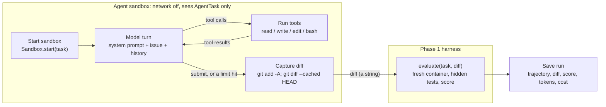

# Phase 2: Bare Agent Loop (Details)

As of 2026-10-10. Expands Phase 2 of [PLAN.md](PLAN.md). Builds on the Phase 1 harness ([PHASE1.md](PHASE1.md)).

## Overview

Phase 2 builds the agent: an LLM loop that reads a SWE-bench Lite issue, explores and edits the repo inside the sandbox with four tools, and stops with a patch. The Phase 1 harness then scores that patch. Budget is 1 week.

This is the **floor baseline**: no engineered context, only the issue text, a small system prompt and the tools. Phases 3-4 add context strategies on top of the same loop, and Phase 5 compares them against this baseline. So the loop must be simple, bounded and fully logged, and it must never see the answer.

**Goals**

- An agent that attempts a task end to end: issue in, diff out, scored by `evaluate()`.
- Four tools (`read`, `write`, `edit`, `bash`) that run inside the Phase 1 sandbox.
- Hard limits on every run: model turns, tokens, wall clock, per-command timeouts.
- A saved record of every run (trajectory, diff, score, tokens, cost) to debug failures and feed Phase 5.

## Scope

Phase 2 covers one agent with no context engineering; anything that chooses context for the model belongs to Phase 3 or later.

| In scope | Out of scope |
| --- | --- |
| The four tools and a small system prompt | Context strategies, repo maps, the code graph (Phases 3-4) |
| A LangGraph loop with a turn cap | Multi-agent setups, planning or reflection steps |
| Running on the 5 dev tasks | Benchmarking on the other 295 tasks (Phase 5) |
| Saving trajectories, diffs, scores, tokens and cost | Dashboards or a tracing UI (Phase 6) |
| A `solve` command: task id in, verdict out | Chat mode, human in the loop |
| Swapping models by config (Gemini and Claude adapters) | A systematic model comparison |

## Architecture

The agent works in the offline Phase 1 sandbox and sees only `task.for_agent()`. Its only output is a diff, which `evaluate()` scores in a fresh container.



The loop ends when the model calls `submit`, or when a limit is hit (turns, tokens, wall clock). In both cases the current diff is captured and scored, so a run always ends with a verdict. The agent can run the repo's existing tests and its own reproduction scripts with `bash`, but never the hidden FAIL_TO_PASS tests: they are not in its container.

**Proposed module layout** (under `src/agent/`; the agent depends on `agent.harness`, never the other way round)

| Module | Responsibility |
| --- | --- |
| `tools.py` | `read`, `write`, `edit`, `bash`, `submit`: run inside a `Sandbox`, return text for the model |
| `prompts.py` | The system prompt and the first user message built from an `AgentTask` |
| `graph.py` | The LangGraph loop (replaces the template scaffold) |
| `solve.py` | `solve(task)`: start the sandbox, run the graph, capture the diff, evaluate, return a `Run` |
| `runs.py` | Save and load runs under `runs/<run_id>/<instance_id>/` |
| `harness/cli.py` | Add `solve <instance_id>` and `solve --dev` next to `run` and `validate` |

## Implementation tasks

Seven tasks, in build order. Each one ends with something you can run.

1. **Wire a swappable model client**
    - Build the model with LangChain's `init_chat_model(config.model)`, where the model is a `"provider:model"` string such as `"google_genai:gemini-3.8-flash"` or `"anthropic:claude-sonnet-5-5"`. The agent code never imports a provider class, so switching is a config change or a `--model` flag.
    - Install both adapters, `langchain-google-genai` and `langchain-anthropic`, and read `GOOGLE_API_KEY` and `ANTHROPIC_API_KEY` from `.env`. A key is needed only for the provider actually used.
    - Develop on a cheap Gemini Flash model. Record the model string in every run.
    - Keep provider differences in one `make_model(config)` function: prompt caching (explicit cache markers for Claude, automatic for recent Gemini models) and a small price table per model for `cost_usd`.
2. **Build the tools**
    - `read(path, start_line?, end_line?)`: file contents with line numbers, capped in length; a directory path lists its entries.
    - `write(path, content)`: create or overwrite a file.
    - `edit(path, old, new)`: replace one exact, unique occurrence of `old`; fail with a clear message if it is missing or not unique.
    - `bash(command)`: run in `/testbed` with a timeout; return exit code plus output, truncated from the middle.
    - `submit()`: end the run.
    - Paths resolve inside `/testbed`. Every tool returns a string; errors are returned to the model as tool results, never raised.
3. **Write the prompts**
    - A short system prompt: the job (fix the issue with a minimal change to non-test code), the tools, the working directory, that there is no network, and to reproduce the bug before fixing when possible.
    - The first user message: repo name and `problem_statement`, built from `AgentTask` only.
4. **Build the loop**
    - LangGraph: a model node and a tool node in a loop, ending on `submit` or a limit.
    - Limits: about 30 model turns, a token budget, a wall-clock budget; `bash` keeps the sandbox's per-command timeout.
    - On a limit, stop cleanly and still capture the diff.
5. **Capture, evaluate, save**
    - `solve(task)`: run the agent in `Sandbox.start(task)` (offline), capture `git add -A && git diff --cached HEAD`, call `evaluate(task, diff)`.
    - Save the trajectory (every message and tool call), the diff, the `Evaluation`, turns, tokens, cost and wall clock.
6. **Run the dev tasks**
    - `uv run harness solve --dev` runs all five, prints a verdict table, and saves every run.
    - Read every failed trajectory by hand and fix tool or prompt problems (for example, `edit` failures or truncated output hiding the error), not the model's reasoning.
7. **Check isolation and limits**
    - Test that the prompt and every message sent to the model contain no `gold_patch`, `test_patch` or `eval_script` text.
    - Test that every limit stops a run: turns, tokens, wall clock, a hanging `bash` command.
    - Flag runs where the agent reads the task's package outside `/testbed` (the newer `requests` releases in the images; see [DEV_TASKS.md](DEV_TASKS.md)).

**Core types (proposed)**

```python
class AgentConfig(BaseModel):
    model: str  # "provider:model", passed to init_chat_model
    max_turns: int = 30
    max_tokens: int  # total, input + output
    max_wall_clock_s: float
    bash_timeout_s: float = 120

class ToolCall(BaseModel):
    name: Literal["read", "write", "edit", "bash", "submit"]
    args: dict[str, Any]
    output: str  # what the model saw, after truncation
    runtime_s: float

class Run(BaseModel):
    instance_id: str
    config: AgentConfig
    stop_reason: Literal["submitted", "max_turns", "max_tokens", "max_wall_clock", "error"]
    turns: int
    input_tokens: int
    output_tokens: int
    cost_usd: float
    diff: str
    evaluation: Evaluation  # from agent.harness.evaluate
    runtime_s: float

def solve(task: Task, config: AgentConfig) -> Run: ...
```

`solve` takes the full `Task` because it calls `evaluate()`; only `task.for_agent()` reaches the prompt.

## Definition of done

Phase 2 is done when every box below is ticked.

- [ ] One command runs the agent on a task and prints the verdict, turns, tokens, cost and runtime.
- [ ] The agent attempts all 5 dev tasks end to end, each ending in a scored diff (any pass rate).
- [ ] Every run stops within its turn, token and wall-clock limits, and records why it stopped.
- [ ] Nothing the model receives contains the gold patch, the test patch or the eval script, and its sandbox has no network.
- [ ] Every run is saved: trajectory, diff, evaluation, tokens, cost.
- [ ] Failed dev runs are reviewed by hand, with the findings written down.
- [ ] Cost and runtime per task are recorded; they feed the Phase 5 budget.

## Risks and open questions

The biggest risks are cost and silent tool failures, not the loop itself.

| Risk | Mitigation |
| --- | --- |
| Runaway cost from long loops or huge tool outputs | Turn and token caps per run; truncate tool output; prompt caching; a cheap model for development; develop on 1-2 tasks before running all 5 |
| A cheap model makes more tool-call mistakes (malformed `edit` calls, giving up early), so failures reflect the model, not the tools | Read trajectories to tell the two apart; rerun a few dev tasks on Claude to compare |
| Free-tier API limits stall a batch of runs, or free-tier prompts are used for training | Retry with backoff on rate-limit errors; use a paid key for batches; send only open-source SWE-bench code |
| Tool output floods the context (a full test suite log, a large file) | Cap `read` length, truncate `bash` output from the middle, keep the exit code |
| `edit` fails often (whitespace, non-unique matches), so the agent wastes turns | Clear error messages that say why and how to fix the call; count `edit` failures per run |
| The agent edits tests to make them pass | The eval script resets test files and runs the hidden tests, so this cannot score; the prompt also asks for non-test changes |
| Emulated x86 containers make `bash` slow (test runs, imports) | Per-command timeout; tell the agent to run single test files, not the whole suite |
| The patch drags in scratch files (reproduction scripts) | Harmless to scoring, but noisy; decide whether to drop untracked files outside the repo's source dirs |
| Answer leakage through the images (newer `requests` releases) | Flag reads of the task's package outside `/testbed`; report those runs separately |

**Open questions**

- Which model for the Phase 5 baseline? Development uses Gemini Flash. Run the dev tasks on Gemini and Claude, then choose from measured pass rate and cost per task. Every Phase 5 condition must use the same model.
- PLAN.md says "loop on failure (cap about 5 iterations)". Is an iteration a model turn, or an edit-and-test cycle? A tool loop needs many more than 5 turns, so this doc assumes about 30 turns.
- Should the diff include new untracked files the agent created (reproduction scripts), or only changes under the repo's source directories?
- Where do run records live long term: `runs/` ignored by git, or committed for the write-up?

**Next:** Phase 3 adds a `ContextStrategy` protocol at the point where the first user message is built, so the loop stays identical across `none`, `full_file` and `repo_map`.
