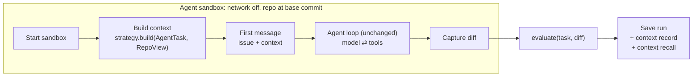

# Phase 3: Context Strategy Plugins (Details)

As of 2026-10-11. Expands Phase 3 of [PLAN.md](PLAN.md). Builds on the Phase 2 agent ([PHASE2.md](PHASE2.md)) and its measured baseline ([DEV_RUNS.md](DEV_RUNS.md)).

## Overview

Phase 3 makes the agent's starting context a swappable plugin. Before the loop starts, a context strategy looks at the issue and the repo, picks code, and puts it in the first user message. Everything else stays fixed: the system prompt, the tools, the loop, the limits and the model. Phase 5 then compares strategies on the same tasks, so any difference in score comes from the context alone. Budget is 1 week.

Phase 2 showed where context could help. On the dev tasks the agent spends many of its turns finding the code before it edits anything (Gemini 3.8 Flash took 14-24 turns, or never edited), and every turn resends the history, so long searches used up a run's 1M-token budget (`pytest-dev__pytest-7220` on Gemini 2.5 Flash). A strategy that hands over the right code up front should cut turns and cost, and may raise the pass rate. It may also crowd the context with wrong code. Measuring that is the point of this phase.

**Goals**

- A `ContextStrategy` protocol, and three strategies: `none` (the Phase 2 baseline, unchanged), `full_file` and `repo_map`.
- Swapping strategies is one config change (`AgentConfig.context`, or `--context` on `harness solve`).
- Every run records which code its strategy chose and why, as structured data.
- A measure of selection quality that does not depend on the agent: did the context include the files the fix touches?

## Scope

Phase 3 covers context chosen once, before the first model turn. Anything that changes context during a run, or builds a code graph, belongs to a later phase.

| In scope | Out of scope |
| --- | --- |
| The `ContextStrategy` protocol and a registry of strategies | The code graph and graph traversal (Phase 4) |
| `none`, `full_file`, `repo_map` | Embeddings, vector search, an LLM choosing the context |
| One shared file ranking, so `full_file` and `repo_map` differ only in how they render | Changing context mid-run: trimming history, summarising, re-retrieval |
| Recording the selected context and its reasons on every run | Changes to the system prompt, tools or loop |
| A context recall metric, computed after evaluation | The benchmark on the remaining 270 tasks (Phase 5) |
| Three dev batches per strategy | A model comparison |

## Architecture

The strategy runs in the sandbox before the agent starts, with the repo at its base commit (like `hidden_lines`). It sees only the `AgentTask` and the repo, never the `Task`. Its output becomes part of the first user message.



`none` returns empty context, so its first message is byte-for-byte the Phase 2 one: the baseline is reproduced, not re-implemented.

Context goes in the first user message, not the system prompt, so the system prompt stays identical across strategies and tasks. The first message is fixed for the whole run, so it stays in the cached prefix after the first turn and costs cache-read prices from then on.

**Proposed module layout** (under `src/agent/context/`)

| Module | Responsibility |
| --- | --- |
| `__init__.py` | Re-exports the package's public names |
| `base.py` | The `ContextStrategy` protocol, and the `Context` and `ContextItem` types (apart from `__init__.py`, so `strategies.py` can import them without a cycle) |
| `repo.py` | `RepoView`: read-only access to the repo through the sandbox (`git ls-files`, read a file, `git grep`) |
| `rank.py` | The shared file ranking: terms from the issue, scored against paths, definitions and contents |
| `strategies.py` | `none`, `full_file`, `repo_map`, the registry (`STRATEGIES`, `get_strategy(name)`), and `build_context`, which times a strategy |
| `skeleton.py` | A file's skeleton for `repo_map`: imports, classes, functions and signatures, from Python's `ast` |

Changes elsewhere: `first_message(task, context)` in `prompts.py`, `context` and `context_budget_chars` in `AgentConfig`, the context record and recall in `Run`, and `--context` in the CLI.

## Implementation tasks

Seven tasks, in build order. Each ends with something you can run.

1. **Define the protocol and wire it through**
    - `ContextStrategy` with a `name` and `build(task, repo, budget_chars) -> Context`; a registry keyed by name.
    - `AgentConfig.context: str = "none"` and `--context` on `harness solve`; an unknown name fails before any sandbox starts.
    - `--context` also takes a list (`--context none,full_file,repo_map`) and `--repeat N` runs it N rounds, interleaved as in task 7.
    - `first_message(task, context)` adds a section only when the context is not empty. Test that `none` produces exactly the Phase 2 message.
2. **Give strategies read access to the repo**
    - `RepoView` over the sandbox's `Shell`: list tracked Python files, read a file, `git grep`. No writes.
    - Strategies run before the agent, while the repo is at its base commit.
3. **Rank files from the issue**
    - Extract terms from the issue: file paths, dotted names, identifiers in backticks and code blocks, frame paths in tracebacks.
    - Score each tracked Python file: a path mentioned in the issue, a definition (`def`, `class`) of a term, mentions of terms in its contents. Prefer source files over tests, and cap how much any single term can add.
    - Return ranked files, each with the reasons for its score (for example `defines iter_content`, `path in traceback`). Deterministic: the same task always gives the same ranking.
    - **Checkpoint before any agent run: ranking recall.** The share of files the gold patch changes that are in the top-k ranked files, computed from `Task.gold_patch` after ranking and never passed to a strategy or the agent. It needs only the task's sandbox, no API calls, so measure it on the 5 dev tasks and 25 tuning tasks (`harness rank --dev`, `harness rank --tuning`). The dev tasks have no django or sympy, which are 191 of Lite's 300, so the tuning tasks are drawn by repo with a fixed seed. Rules may change after seeing them, so they are excluded from Phase 5, like the dev tasks. If recall is low, improve the ranking before building the strategies: neither can do better than the files it is given. Results: [RANKING.md](RANKING.md).
4. **`full_file`**
    - The top-ranked files, whole and with line numbers (as `read` shows them), until the budget is used.
    - A file too big for the remaining budget is not skipped: the most relevant source files are often larger than the whole budget (`requests/models.py` is 861 lines, `src/_pytest/_code/code.py` 1,217). Show the functions and classes that match the issue's terms, each in full with line numbers, plus the file's imports; mark the item `trimmed`. Never cut a function in the middle.
5. **`repo_map`**
    - Skeletons of the top-ranked files: imports, class and function signatures with line numbers, the first line of each docstring. Far smaller per file, so it covers more files in the same budget.
    - Fall back to the file's `def` and `class` lines when `ast` cannot parse it (old Python 2 syntax).
6. **Record and measure**
    - Save the `Context` on every `Run`: strategy, rendered text, items with scores and reasons, size, build time.
    - Context recall: the share of files the gold patch changes that appear in the context, the same measure as task 3's ranking recall but for what the strategy actually showed. Computed after evaluation, from `Task.gold_patch`; it is stored on the run and never reaches the agent.
    - The isolation checks already cover the first message; add a test that a strategy's context passes `hidden_text_seen`.
7. **Run and compare**
    - Three rounds on the dev tasks with Gemini 2.5 Flash, all strategies interleaved: in each round every task runs under `none`, `full_file` and `repo_map`, and the strategy that goes first rotates from round to round. Running one strategy's batches after another's would turn drift over the hour (provider load, rate limits, warm images, credits running out) into apparent strategy effects. Each round and strategy gets its own run id (for example `cmp-1-full_file`). 45 runs, about $1.80 at Phase 2's cost.
    - A table per strategy: pass rate, turns, tokens, cost, runtime, context recall. Read every run where a strategy did worse than `none` and write down why. Five tasks are too few for conclusions: one run flipping moves a strategy's pass rate by about 7 points, so treat the table as a check that each strategy works and does not obviously hurt.

**Core types (proposed)**

```python
class ContextItem(BaseModel):
    path: str
    kind: Literal["file", "skeleton"]
    trimmed: bool  # full_file: only the matching functions of a file too big to show whole
    score: float
    reasons: list[str]  # e.g. "defines iter_content", "path in traceback"
    chars: int

class Context(BaseModel):
    strategy: str
    text: str  # the section added to the first message; "" for none
    items: list[ContextItem]
    build_s: float

class ContextStrategy(Protocol):
    name: str
    def build(self, task: AgentTask, repo: RepoView, budget_chars: int) -> Context: ...

# On Run, alongside the existing fields:
#   context: Context
#   context_recall: float | None  # gold-patch files in the context; None for "none"
```

## Definition of done

Phase 3 is done when every box below is ticked.

- [ ] Swapping strategies is one config change (`--context none|full_file|repo_map`).
- [ ] `none` produces exactly the Phase 2 first message.
- [ ] `full_file` and `repo_map` run on all 5 dev tasks, use the same ranking, and stay within the context budget.
- [ ] Every run records its context: what was chosen, why, and how big it is.
- [ ] Context recall is reported for every run, and nothing from the gold patch reaches the agent.
- [x] Ranking recall is measured on the dev tasks and a sample of Lite tasks before any agent run ([RANKING.md](RANKING.md): recall@3 0.77, @10 0.90 over 30 tasks).
- [ ] Three interleaved rounds on the dev tasks, with a comparison table and the worse-than-`none` runs reviewed by hand.

## Risks and open questions

The biggest risk is a comparison that measures the budget or the ranking rather than the strategy.

| Risk | Mitigation |
| --- | --- |
| `full_file` and `repo_map` differ in more than rendering, so the comparison is unclear | One shared ranking and one budget; the strategies only decide how much of each ranked file to show |
| Bad ranking makes both strategies look useless | Measure ranking recall before building the strategies (task 3); report context recall separately from the pass rate: low recall is a ranking problem, high recall with no gain is a strategy problem |
| Wrong code in context misleads the agent | Label the section as automatically selected and possibly incomplete; read worse-than-`none` runs |
| More context in every turn raises cost | The first message is in the cached prefix after turn 1; record tokens and cost per strategy |
| Five tasks are too few to tell strategies apart | Three interleaved rounds; treat the dev table as a sanity check and leave conclusions to Phase 5 |
| Drift over a long comparison (provider load, rate limits, credits) looks like a strategy effect | Interleave strategies within each round and rotate which goes first |
| Old repos use Python 2 syntax that `ast` cannot parse | Fall back to `def` and `class` lines, and count the fallbacks |
| Ranking on the dev tasks overfits to them | Keep ranking rules generic (no repo-specific rules); tune only on the dev and tuning tasks, which Phase 5 excludes |

**Open questions**

- How large should the context budget be? Phase 2's `read` cap is 16,000 characters. A budget of about 24,000 characters (about 6k tokens) gives `full_file` two or three files and `repo_map` a dozen or more; is one budget fair to both, or should each be tested at two sizes?
- Should the ranking include test files? The hidden tests are not in the repo, but existing tests near the bug show how the code is used.
- Should the system prompt tell the agent that context may be provided? Changing it breaks "everything else stays fixed"; the first message can label the section instead.
- ~~Does the growing history need handling before Phase 5?~~ Decided: it is a separate axis, history handling, run as an extra Phase 5 condition ([PLAN.md](PLAN.md)). Phase 3 keeps the loop append-only.

**Next:** Phase 4 adds a graph traversal strategy behind the same protocol: build a code graph with `ast`, start from the ranked entry points, and follow calls and imports N hops to choose context.
